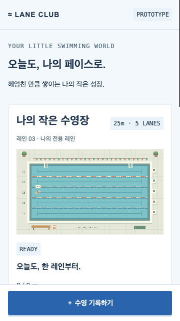

# GitHub Pages 배포 검증 · 2026.11.02

대상: https://slur16105.github.io/swim/ · Chrome156/macOS · 공개 HTTPS에서 실제 배포 번들을 실행했다. 실기기 iOS/Android·200% 확대·스크린리더 실행은 사용자가 담당하며 이 결과로 대체하지 않는다.

## 검증 방법과 데이터 보호

기존 사용자 기록을 건드리지 않도록 검증 브라우저에서만 저장 어댑터의 논리 키 `lane-club:v1`을 별도 실제 LocalStorage 키 `lane-club:pages-check:20261102`에 매핑했다. 배포 HTML/JS/CSS 및 앱 도메인·Store·Phaser 코드는 수정하지 않았고, 실제 LocalStorage·공개 origin의 Web Locks·native dialog를 사용했다. 두 탭의 검증 키 storage 이벤트도 논리 키로 전달했다. 따라서 저장 경로는 격리한 시험이며 원래 제품 키의 기존 사용자 데이터 검증을 주장하지 않는다. 새 문서 탐색에도 격리를 적용한 상태로 재방문을 확인했다. 실제 제품 키는 변경하지 않았으며, 검증 종료 때 예상 v2/revision1/pages-v1 원문과 완전히 일치하는 검증 키만 삭제했다.

## 결과

|항목|결과|
|---|---|
|HTTPS·Web Locks·게임 캔버스|secureContext=true, navigator.locks.request 함수, Phaser canvas 생성|
|생성 취소|색 변경 후 폐기 시 저장 없음|
|생성 저장|pink/green/pink 색상 저장, 기록 입력 가능|
|1000m/40분 저장|pending 기록 1개, 완료 전 XP 없음|
|일시정지·4배속 중 꾸미기|green/green/pink 저장 뒤 PAUSED와4× 유지|
|수영 완료|complete, 400XP, LV3, 다음100/300, revision4|
|새로고침|외형·기록·LV3·100/300 복원|
|다시보기|XP 추가 없음, revision4 유지|
|완료 기록500m/20분 수정|기록1개 유지, 200XP, LV2, 다음100/200, revision5|
|두 탭 충돌|변경 탭의 확정 외형을 다른 탭이 덮어쓰지 않음. 초안 유지·save 비활성|
|명시적 복구|Escape로 확인 취소 가능, 확인 후 최신 pink 외형·200XP, editor-title 초점|
|v1 읽기|pink 수모 유지, 수경/수영복 dark, raw version1 유지,400XP|
|v1 첫 저장 이관|v2/revision1, suit orange, 기존1000m complete·note 보존,400XP|
|360×640 화면|페이지 가로 넘침0, 캔버스 생성·표시, 아래 캡처|

다시보기 완료 대기는 도구 환경에서 예상 시간보다 길어져 추가 대기 후 완료를 확인했다. 이 기록은 휴대폰 프레임률/성능 인증이나 실제 운동 시간 측정이 아니다. 배포 사이트에서 데이터 손상·중복XP·저장 실패를 성공으로 알리는 문제는 위 시나리오에서 발견하지 못했다.

## 자산·캐시 확인

실제 로드한 자산은 `/swim/assets/index-CT-YizlG.js`와 `/swim/assets/index-DvYvXkba.css`다. 공개 HTML 및 참조 JS/CSS HTTP200, 로컬 `/swim/` 빌드와 바이트 일치를 확인했다. 응답 MIME은 HTML `text/html`, JS `application/javascript`; 브라우저 resource 목록은 같은 origin의 해당 JS/CSS만 포함했다. 기록·외형의 별도 서버 전송 요청은 관찰되지 않았다. 이것은 호스팅 접근 로그/쿠키 정책에 대한 인증은 아니다.

GitHub 응답은 HTML/JS 모두 `Cache-Control: max-age=600`, 해시 자산명, ETag와 HTTPS HSTS를 제공했다. 새로고침 뒤 같은 검증 자산을 로드했다. 새 배포 후 기존 HTML/열린 탭이 즉시 전환된다고 보장하지 않는다. 구버전 탭 종료·전환/롤백은 [실행서](release-runbook.md)를 따른다.

## 병행 완료와 남은 작업

- 자동 배포에서 dist 아카이브·개별 파일 SHA256·전체 체크섬·소스 commit/run 메타데이터를 30일 보관하도록 추가했다. 실제 보관 검증은 성공한 Actions 실행과 내려받은 artifact의 체크섬 대조로 별도 기록한다.
- 공개 경로 `/swim/` 안내와 내부 문서 링크를 수정했다. 저장소는 경로가 아닌 origin별이라는 점을 README에 명시했다.
- 실제 사용자 환경을 다른 빌드로 되돌리는 롤백은 실행하지 않았다. 보관 산출물 검증과 실제 운영 롤백을 구분한다.
- 실기기·보조기술 결과는 [결과표](mobile-device-results.md)에 이어서 기록한다. Story1.7 전체 수용 완료는 아직 아니다.

## 보관 산출물 실검증

[Actions 실행41392479192](https://github.com/slur16105/swim/actions/runs/41392479192)은 테스트104개·빌드·보관·Pages 배포가 모두 성공했다. 소스는 `4cc88e9bc954d758a9e1ece7983e112baa385249`, 보관 이름은 `pages-release-4cc88e9bc954d758a9e1ece7983e112baa385249`, artifact ID는 `13117058867`이다. 30일 보관 정책이며 삭제·만료 전 별도 보관이 필요하다.

실제 artifact를 내려받아 SHA256SUMS의 아카이브·파일목록·메타데이터3개, 압축 해제 뒤 index.html과 JS/CSS3개의 SHA256을 모두 확인했다. 메타데이터의 repository/run/source commit이 GitHub 실행과 일치한다. 공개 HTTPS에서 받은 index/JS/CSS와 복원 디렉터리 파일이 바이트 단위로 일치했다. 검증된 아카이브와 소스 식별자는 확보했으나 실제 운영 롤백 배포는 실행하지 않았다. 이번 변경은 배포 파이프라인·문서뿐이며 제품 JS/CSS는 위 실제 브라우저 검증과 동일하다.
